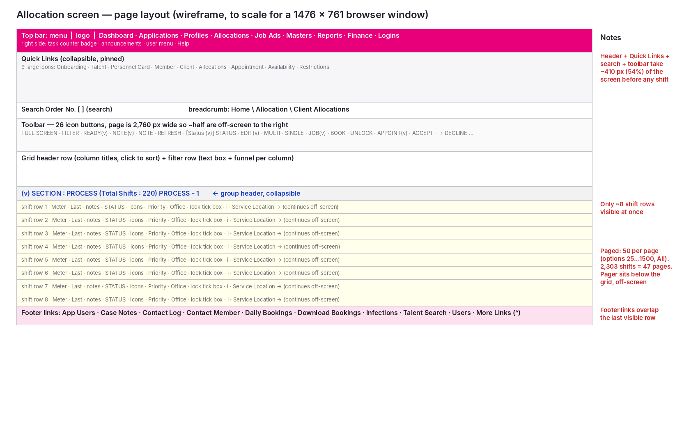
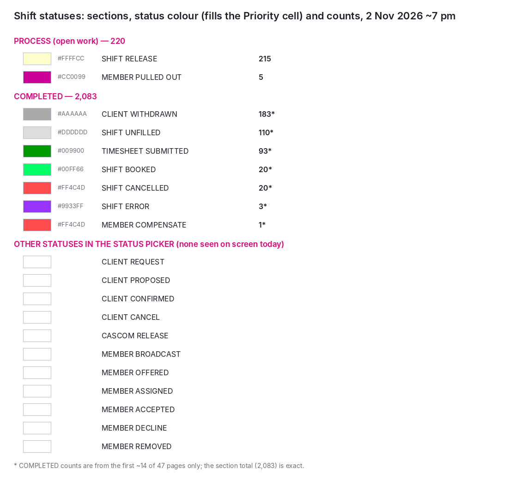
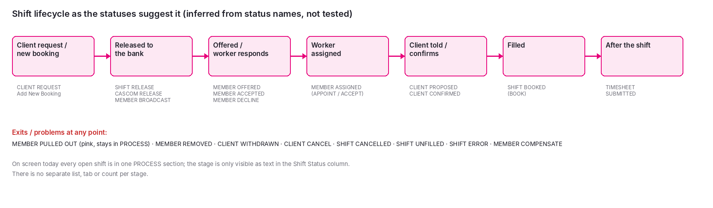
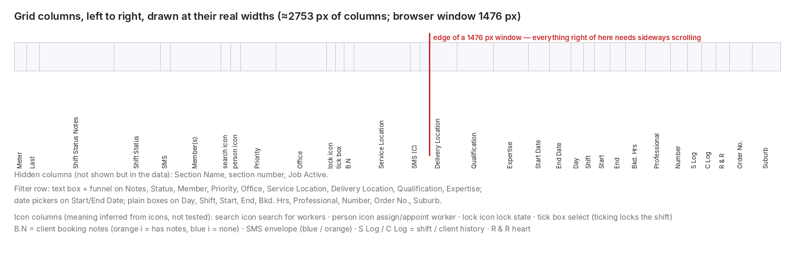
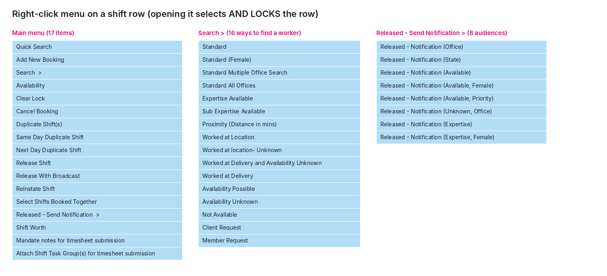

# Current allocation screen: how it is laid out

Reference notes on the agency's existing shift allocation screen ("Client Allocations", a third-party staffing system), written to brief the team designing the CROP allocation module.

- Observed: Monday 2 November 2026, around 7 pm, in a 1476 × 761 px Chrome window.
- Method: read-only. Nothing was assigned, released, notified, saved or deleted.
- All worker, client, site and staff names have been replaced with placeholders ("Worker A", "Client 1 – Site X", "Ward 1", "ORD-1001"). There are no phone numbers, emails or addresses.
- The images are wireframes and diagrams redrawn from what was on screen, not screenshots, so that no real data is included.
- Anything marked *(inferred)* was read from a label, icon or status name and was not tried.

---

## 1. Overall layout

From top to bottom:

1. **Top bar** (pink). Hamburger menu, agency logo and the main menu: Dashboard, Applications, Profiles, Allocations, Job Ads, Masters, Reports, Finance, Logins. On the right: a task counter badge (refreshes every 20 s), an announcements icon, the user menu and Help.
2. **Quick Links** panel, pinned open and collapsible. Nine large icons: Onboarding, Talent, Personnel Card, Member, Client, Allocations, Appointment, Availability, Restrictions.
3. **Search Order No.** box on the left; breadcrumb (Home \ Allocation \ Client Allocations) on the right.
4. **Toolbar**: one long row of 26 icon-and-label buttons (see section 5).
5. **The grid** (a Kendo UI grid): column titles, a filter row under them, then the shifts grouped into **sections** with collapsible headers such as "SECTION : PROCESS (Total Shifts : 220)". Hovering a section header shows a timing tooltip ("DB Execution Time : 1.4 Sec | Total Time Elapsed : 1.46 Sec").
6. **Pager** under the grid: 50 shifts per page by default, with options for 25, 100, 500, 1000, 1500 and All.
7. **Footer link bar**, fixed at the bottom: App Users, Case Notes, Contact Log, Contact Member, Daily Bookings, Download Bookings, Infections, Talent Search, Users, More Links.

There are **no side panels**. Everything sits in one full-width column.

**How much fits on one screen:**
- The header, Quick Links, search row, toolbar and grid headings take about 410 px, more than half the window, before the first shift.
- Only **about 8 shift rows** are visible at once, and the fixed footer covers part of the last one.
- The page is **about 2,760 px wide**, nearly twice the window, so the right half of the toolbar and more than half the columns need sideways scrolling. The whole page scrolls sideways, not just the grid.

## 2. Stages

Stages are **not** shown as separate lists, tabs or columns. All shifts sit in one grid, grouped into two **sections**:

| Section | Shifts now | What is in it |
|---|---|---|
| **PROCESS** | 220 | Open work: 215 at *Shift Release*, 5 at *Member Pulled Out* |
| **COMPLETED** | 2,083 | Closed shifts. From the first ~14 pages: Client Withdrawn 183, Shift Unfilled 110, Timesheet Submitted 93, Shift Booked 20, Shift Cancelled 20, Shift Error 3, Member Compensate 1 |

Total: 2,303 shifts across 47 pages. The open shifts in PROCESS run from 2 to 6 November.

Within a section, the stage is shown only by the **Shift Status** column: a blue link (for example "SHIFT RELEASE") with an envelope icon beside it. Each status also has a **colour code, which fills the Priority cell** (yellow for Shift Release, magenta for Member Pulled Out, green for Booked or Timesheet Submitted, red for Cancelled, grey for Withdrawn or Unfilled, purple for Error).

The full status list, taken from the status picker in the toolbar, and the order it implies:

| Your stage | Statuses that match it |
|---|---|
| New shift | CLIENT REQUEST (or created with *Add New Booking*) |
| Released to the bank | SHIFT RELEASE, CASCOM RELEASE, MEMBER BROADCAST |
| Offered / worker responds | MEMBER OFFERED, MEMBER ACCEPTED, MEMBER DECLINE |
| Worker assigned | MEMBER ASSIGNED |
| Client notified / confirms | CLIENT PROPOSED, CLIENT CONFIRMED |
| Filled | SHIFT BOOKED |
| After the shift | TIMESHEET SUBMITTED |
| Problems / exits | MEMBER PULLED OUT, MEMBER REMOVED, CLIENT WITHDRAWN, CLIENT CANCEL, SHIFT CANCELLED, SHIFT UNFILLED, SHIFT ERROR, MEMBER COMPENSATE |

Right now every open shift is either *Shift Release* or *Member Pulled Out*. No shift was sitting at Accepted, Assigned or Client Notified, so the stages between "released" and "booked" seem to be passed through quickly or not used on this screen.

## 3. Columns

There are 32 visible columns, left to right. Widths are the screen's own, in pixels.

| # | Column | Width | What it shows |
|---|---|---|---|
| 1 | Meter | 45 | Elapsed-time counter (hh:mm), red text. Appears to time how long the shift has been waiting since it was requested or released *(inferred)*. Truncated to "06…" |
| 2 | Last | 45 | Time of the last action on the shift. Truncated |
| 3 | Shift Status Notes | 265 | Running log of actions in shorthand, e.g. `**SMS 18:46 PTO 18:43 Shift Release from …`, "Declined from Mobile", "Shift edited by user … ENTERED BY CLIENT". Cut off after one line; the full text appears in a hover tooltip |
| 4 | Shift Status | 165 | Envelope icon (blue, or orange on some rows) + status link, e.g. "SHIFT RELEASE" |
| 5 | SMS | 35 | Round "m" message icon. Appears to message the worker *(inferred)* |
| 6 | Member(s) | 180 | Assigned worker name(s); empty for unfilled shifts |
| 7 | (search icon) | 35 | Magnifier. Appears to open a worker search for this shift *(inferred)* |
| 8 | (person icon) | 35 | Person icon. Appears to assign or appoint a worker *(inferred)* |
| 9 | Priority | 125 | Number 1–7, in a cell filled with the status colour. Today's mix: 1×3, 2×30, 3×8, 4×7, 6×1, 7×1 on page 1 |
| 10 | Office | 180 | Agency office or region, e.g. "VIC MELBOURNE METRO", "QLD SUNSHINE COAST" |
| 11 | (lock) | 33 | Padlock: open (blue) = free, closed (red) = someone is working on it |
| 12 | (tick box) | 30 | Selects the shift **and takes the lock** (see the box below) |
| 13 | B.N | 35 | "i" icon for client booking notes: orange = notes exist, blue = none *(inferred)* |
| 14 | Service Location | 200 | Client and site, e.g. "CLIENT 1 – SITE X". Some show in red *(meaning not checked)* |
| 15 | SMS | 35 | Round "C" icon. Appears to message the client *(inferred)* |
| 16 | Delivery Location | 130 | Ward or unit within the site, e.g. "WARD 1"; often blank |
| 17 | Qualification | 130 | Required qualification codes, e.g. "RN", "RN+JRN", "AIN+AIN SN" |
| 18 | Expertise | 125 | Required specialty, e.g. "EXPERTISE 1"; often blank |
| 19 | Start Date | 75 | 02/11/2026 |
| 20 | End Date | 75 | 02/11/2026 (the date the shift starts, even for overnight shifts) |
| 21 | Day | 45 | MON, TUE … |
| 22 | Shift | 40 | Shift code: AM, PM, NS (night) |
| 23 | Start | 55 | 21:00 |
| 24 | End | 55 | 07:30 |
| 25 | Bkd. Hrs | 70 | Booked hours, e.g. 10.30 |
| 26 | Professional | 90 | Worker type, e.g. "PROFESSIONAL 1"; truncated |
| 27 | Number | 60 | Staffing ratio, e.g. 1:1, 1:2 (blue link) |
| 28 | S Log | 50 | Clock icon. Shift history *(inferred)* |
| 29 | C Log | 50 | Clock icon. Client history *(inferred)* |
| 30 | R & R | 50 | Heart icon *(meaning not checked)* |
| 31 | Order No. | 80 | Client order number, e.g. ORD-1002; often blank |
| 32 | Suburb | 100 | Client suburb |

Hidden in the data but not shown: Section Name, section number, Job Active.

**Example row (placeholders):**

| Meter | Last | Notes | Status | Priority | Office | Lock | B.N | Service Location | Delivery | Qual. | Date | Day | Shift | Start–End | Hrs | Ratio |
|---|---|---|---|---|---|---|---|---|---|---|---|---|---|---|---|---|
| 00:41 | 18:42 | `**SMS 18:46 PTO 18:43 Shift Release` | SHIFT RELEASE | 2 (yellow) | VIC MELBOURNE METRO | open | orange i | Client 1 – Site X | Ward 2 | RN+EEN | 02/11/2026 | MON | NS | 21:00–07:30 | 10.30 | 1:1 |

> **Shift locking.** The lock stops more than one person working on the same shift at a time. **Ticking a shift's checkbox takes the lock, and so does right-clicking the row**: right-click selects the row, ticks its box and locks it to you, and the padlock turns red. **Unticking the checkbox releases the lock.** The UNLOCK button and the right-click "Clear Lock" item also release it. If you try to leave the page while holding locks, the browser warns: *"Please unlock your shifts before close or navigate away from this page."*
>
> Design note for CROP: a lock should be visible to everyone (who holds it, and since when), and should never be taken just by opening a menu.

## 4. Urgency: what brings a job to the top

- **Sort order:** within each section, shifts are sorted by **shift date, then start time**, so the soonest shift comes first. Priority does **not** change the order: a Priority 7 shift sits between Priority 2 shifts. Clicking any column title re-sorts the grid.
- **Meter:** a red elapsed-time counter on every row is the main "how long has this been waiting" signal. It is the narrowest column and is truncated, so it shows only the first two digits (e.g. "79…").
- **Priority cell:** a number from 1 to 7 with the status colour behind it. Today almost every open row is yellow, because nearly all are Shift Release, so colour doesn't separate urgent from routine. The 5 *Member Pulled Out* rows stand out in magenta.
- **Other things that draw the eye:** orange envelopes and orange "i" icons among blue ones, some Service Locations in red, and red padlocks on locked shifts.
- **Not there:** no countdown to shift start, no "starting in under 2 hours" flag, and no separate urgent list or count. The only counts are the section totals.

## 5. Actions

### Toolbar (top, one row, about 2,760 px wide)

| Button | Menu items / what it appears to do *(from labels; not tried)* |
|---|---|
| FULL SCREEN | Expand the grid |
| FILTER | Show or hide filters |
| READY ▾ | Standby; Double Shift |
| NOTE ▾ | Fin Note; Shift Worth; Case Note |
| NOTE | Add a note to the selected shift |
| REFRESH | Reload the grid |
| [Status picker] + STATUS | Choose one of 19 statuses and apply it to the selected shift(s) |
| EDIT ▾ | Single Shift; Multiple Shift |
| MULTI / SINGLE | Book or allocate multiple / single shifts *(inferred)* |
| JOB ▾ | Create Job; Edit Job; Create Job Roster; Extend Job |
| BOOK | Book (fill) the shift |
| UNLOCK | Release locks you hold |
| APPOINT ▾ | Appoint a worker (menu not opened) |
| ACCEPT / DECLINE | Record the worker's acceptance or decline |
| REMOVE / UNASSIGN | Take a worker off the shift |
| CONFIRM | Client confirmed |
| CANCEL / WITHDRAW | Shift cancelled / client withdrawn |
| UNFILL | Mark unfilled |
| DOCUMENT | Shift documents |
| MEMBER / CLIENT | Open the worker / client record |

Everything from APPOINT rightwards is off-screen until you scroll sideways. The buttons act on whichever shift(s) are ticked.

### On each row

The status link, the "m" and "C" message icons, the search (magnifier) and person icons, the padlock, the tick box, the B.N info icon, the Office and Service Location links, the ratio link, and the S Log, C Log and R & R icons. See section 3 for what each appears to do.

### Right-click menu on a row

**Main menu (17):** Quick Search · Add New Booking · Search ▸ · Availability · Clear Lock · Cancel Booking · Duplicate Shift(s) · Same Day Duplicate Shift · Next Day Duplicate Shift · Release Shift · Release With Broadcast · ReInstate Shift · Select Shifts Booked Together · Released – Send Notification ▸ · Shift Worth · Mandate notes for timesheet submission · Attach Shift Task Group(s) for timesheet submission

**Search ▸ (16 ways to find a worker):** Standard · Standard (Female) · Standard Multiple Office Search · Standard All Offices · Expertise Available · Sub Expertise Available · Proximity (Distance in mins) · Worked at Location · Worked at location – Unknown · Worked at Delivery and Availability Unknown · Worked at Delivery · Availability Possible · Availability Unknown · Not Available · Client Request · Member Request

**Released – Send Notification ▸ (8 audiences):** Office · State · Available · Available, Female · Available, Priority · Unknown, Office · Expertise · Expertise, Female

The right-click menu is where releasing, broadcasting, duplicating and the detailed worker searches live. **Opening it locks the row.**

## 6. Filters, search, dates, grouping, refresh

- **Search Order No.** box at the top left.
- **Filter row** under the column titles: a text box with a funnel (Contains, Equals, Starts with, Is empty, and so on) on Notes, Status, Member, Priority, Office, Service Location, Delivery Location, Qualification and Expertise. Date pickers on Start and End Date. Plain boxes on Day, Shift, Start, End, Bkd. Hrs, Professional, Number, Order No. and Suburb.
- **Date range:** the Start/End Date pickers are empty by default, so the page loads every shift in both sections, including all 2,083 completed ones.
- **Grouping:** fixed, by section (PROCESS, COMPLETED). Sections collapse but can't be regrouped by office, client or date.
- **Paging:** server-side, 50 per page by default. About 1.4–1.7 s per page load.
- **Auto-refresh:** **no**. The grid only updates when you press REFRESH or change page. Timers on the page only keep the session alive and update the task counter.

## 7. What looks slow or awkward at 200–300 shifts a day

1. **Only about 8 shifts on screen.** Header, Quick Links and toolbar use more than half the height. 220 open shifts is about 28 screens of vertical scrolling on page 1 alone, plus page changes.
2. **Sideways scrolling.** The page is nearly twice the window width. Shift date, time, qualification and hours, which you need to match a worker, are all off-screen to the right of the status and location. The right half of the toolbar is off-screen too.
3. **Open and closed work mixed together.** PROCESS (220) and COMPLETED (2,083) load into the same paged grid. Open work is only about 10 % of the rows, and completed shifts fill 42 of the 47 pages.
4. **No stage view.** There are no per-stage counts, tabs or columns. Seeing "who has accepted but the client hasn't been told" means filtering the Status column by hand.
5. **Urgency is weak.** The grid is sorted by date, not by priority or by how close the shift start is. The colour reflects status, not urgency. The Meter is truncated.
6. **Information hidden in tooltips and menus.** The notes column is cut to one line (full text on hover only). Worker searches are two clicks deep in a right-click submenu. Release and notify options are in another submenu.
7. **Two places for the same actions.** Some actions are on the toolbar, others only in the right-click menu (Release, Broadcast, Duplicate, Notify). The toolbar acts on ticked rows, so most actions are tick → scroll up to the toolbar → scroll sideways → click.
8. **Lock side effects.** Right-clicking to see options locks the shift without warning. People have to remember to untick or UNLOCK, or colleagues are blocked.
9. **No auto-refresh.** Statuses changed by workers on mobile ("Declined from Mobile") or by other staff don't appear until someone presses REFRESH.
10. **Notes as a running log.** Status history is stored as shorthand text in the notes field, e.g. "**SMS … PTO …", which is hard to scan. The S Log and C Log icons suggest a proper history exists elsewhere.
11. **Many near-duplicate options.** 16 search types, 8 notification audiences and 19 statuses suggest a lot of judgement is needed for each shift. Good defaults would save clicks.
